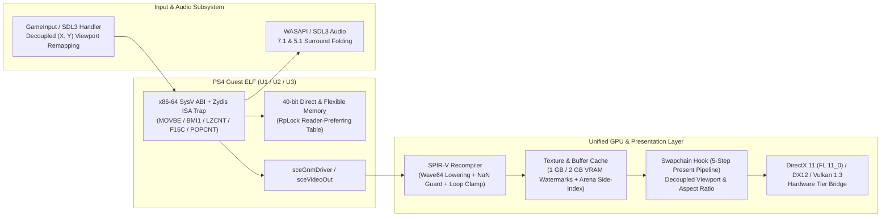

# Uncharted: Sic Parvis Magna Collection — System Architecture

## 1. Architectural Synthesis Overview

**Uncharted: Sic Parvis Magna Collection** unifies the strongest subsystems from five reference generations into a single deterministic PC runtime and presentation architecture:

| Reference Source | Adopted Subsystem | Eliminated Weakness |
| :--- | :--- | :--- |
| **Uncharted PC Port 0.8.4** | Full trilogy runtime (`uncharted1.elf`, `uncharted2.elf`, `uncharted3.elf`), save-data backup & PNG thumbnail decoder (`runtime_savedata.c`, `gow3_thumbnail.cpp`), shared-memory bounds pass, particle effect loop clamp pass, SRW shared mutex, confirmed SDL relative mouse-look | Replaced naive VRAM GC floors (`1.5 GiB` / `3 GiB`) that broke 1 GB and 2 GB GPUs |
| **Performance Fork 0.8.1** | `ArenaAllocations` side-index (`O(k)` arena unmap), single-call `Instance::QueryMemory`, non-inverted `GcAge` policy, deferred `UniqueImage` move into reaper queue with `pending_free_bytes` subtraction, async `CacheIoQueue` | Merged cleanly with all `0.8.4` trilogy gameplay & shader fixes |
| **The Last of Us PC 0.1.6** | Reader-preferring lock (`rwlock_rp.h`) for Windows virtual memory region table (`runtime_memory.c`) | Eliminated nested reader-writer deadlocks under `winpthreads` when page-fault handlers nest inside reader locks |
| **SuperMedo 0.3.13** | 5.1 / 7.1 surround folding (`downmix_51`, `downmix_71`), `GOW3_NAN_GUARD` SPIR-V vertex position sanitizer (`gow3_nan_guard.h`), watchdog-guarded `MiniDumpWriteDump` thread (`probe.c`) | Replaced ad-hoc crash exits with 15-second bounded crash dump threads |
| **SpartanPort 3.0.0** | `GOW3_AMD_PATHS_OFF` vendor-neutral GCN wave-ballot path (`vk_amd_paths.h`), `FrameGenerationPolicy` (`frame_generation_policy.h`) | Eliminated driver-specific RDNA-only assumptions on older GCN / Kepler / Maxwell GPUs |

---

## 2. Core Pipeline & Mathematical Invariants

### 2.1 Swapchain & Viewport Decoupling (Invariant 2.1)
The internal render target dimensions $(\text{Width}_{\text{internal}}, \text{Height}_{\text{internal}})$ are decoupled from the host window client rectangle $(\text{Width}_{\text{client}}, \text{Height}_{\text{client}})$. Letterboxing or pillarboxing is computed deterministically via `unc::graphics::ComputeLetterboxViewport`:

$$\text{Aspect Ratio} = \frac{\text{Width}_{\text{logical}}}{\text{Height}_{\text{logical}}}$$

### 2.2 Input Coordinate Remapping (Invariant 2.2)
Mouse and cursor coordinates in host client space $(X_{\text{client}}, Y_{\text{client}})$ are mapped into internal game space $(X_{\text{game}}, Y_{\text{game}})$ with strictly independent horizontal and vertical scale ratios:

$$X_{\text{game}} = (X_{\text{client}} - \text{Viewport}_X) \times \left(\frac{\text{Width}_{\text{internal}}}{\text{Viewport}_{\text{width}}}\right)$$

$$Y_{\text{game}} = (Y_{\text{client}} - \text{Viewport}_Y) \times \left(\frac{\text{Height}_{\text{internal}}}{\text{Viewport}_{\text{height}}}\right)$$

### 2.3 Present / Present1 Interception Order (Invariant 2.3)
`unc::graphics::SwapchainHook::ExecutePresentPipeline` enforces the 5-step sequence on every frame:
1. `ReadSwapchainDescriptor` (`GetDesc` / `GetDesc1`)
2. `ConsumeDirtyFlags` (atomic acquire-release reset)
3. `ApplyProjectionAndUiScale` (FOV and HUD safe-zone matrices)
4. `RenderCustomOverlays` (telemetry, frame-pacing HUD)
5. `InvokeOriginalPresent` (forwards to the native swapchain vtable target)

---

## 3. 2015+ Entry & Mid-Range Hardware Adaptation

| Hardware Tier | VRAM Budget | RAM Pool (`GOW3_DMEM_MB`) | Graphics Backend | Target Output |
| :--- | :--- | :--- | :--- | :--- |
| **Minimum (2010–2015 Entry)** | 1 GB (`trigger=55%`, `pressure=70%`, `critical=82%`) | `3584 MiB` (`GOW3_LOW_RAM=1`) | DirectX 11 (`D3D_FEATURE_LEVEL_11_0`) / Vulkan 1.3 | 720p @ 30–45 FPS |
| **Recommended (2012–2015 Mid-Range)** | 2 GB (`trigger=55%`, `pressure=70%`, `critical=82%`) | `5056 MiB` (Retail PS4 Direct Pool) | DirectX 11 (`D3D_FEATURE_LEVEL_11_0`) / Vulkan 1.3 | 1080p @ 60 FPS |
| **Modern High-End (2017+)** | 4 GB – 16 GB+ | `5056 MiB` – `9216 MiB` | DirectX 12 (`12_0`+) / Vulkan 1.3 | 1440p / 4K @ 60–120+ FPS |
